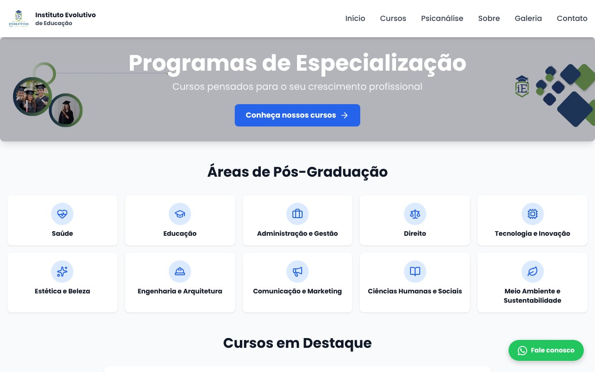

# Instituto Evolutivo de Educação

Site oficial do Instituto Evolutivo de Educação: catálogo de pós-graduação e cursos organizados por área, com página de cada curso e contato direto com o atendimento.

🔗 **No ar:** https://institutoevolutivo.com.br



## Funcionalidades

- **Catálogo por área** (saúde, educação, direito, tecnologia, gestão etc.), com carga horária e duração de cada curso
- **Página dedicada** para o curso de Psicanálise
- **Formulário de contato** que envia os dados para uma API própria (Node.js, hospedada no Railway)
- **Botão de WhatsApp** fixo e botão de interesse em cada curso
- **SEO por página:** título e meta tags definidos por rota
- Páginas de Sobre, Galeria e Depoimentos

## Stack

- React 18 + Vite
- React Router (6 rotas)
- Tailwind CSS
- Lucide Icons
- Deploy na Vercel

## Rodando localmente

```bash
npm install
npm run dev
```

A URL da API pode ser trocada pela variável `VITE_API_URL`.

## Estrutura

```
src/
├── components/   Header, Footer, CourseCard, Depoimentos, SEO, WhatsAppButton
├── pages/        Home, Cursos, CursoPsicanalise, Sobre, Galeria, Contato
├── data/         catálogo de cursos
└── services/     chamadas à API
```
